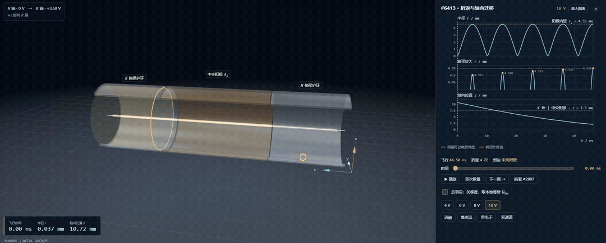
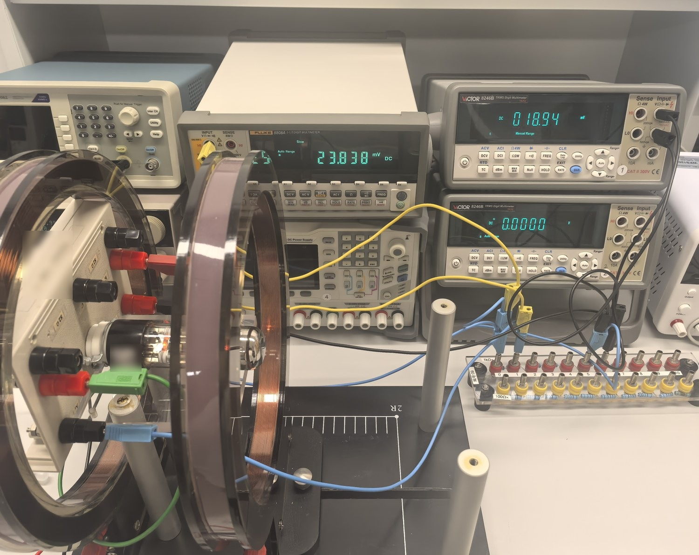
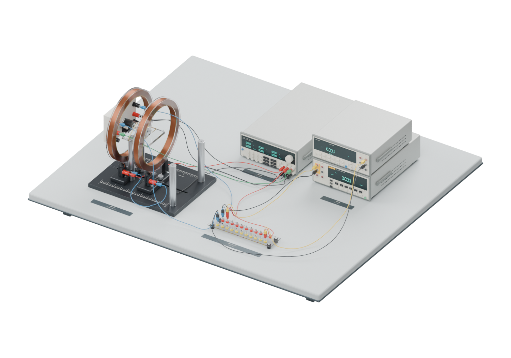
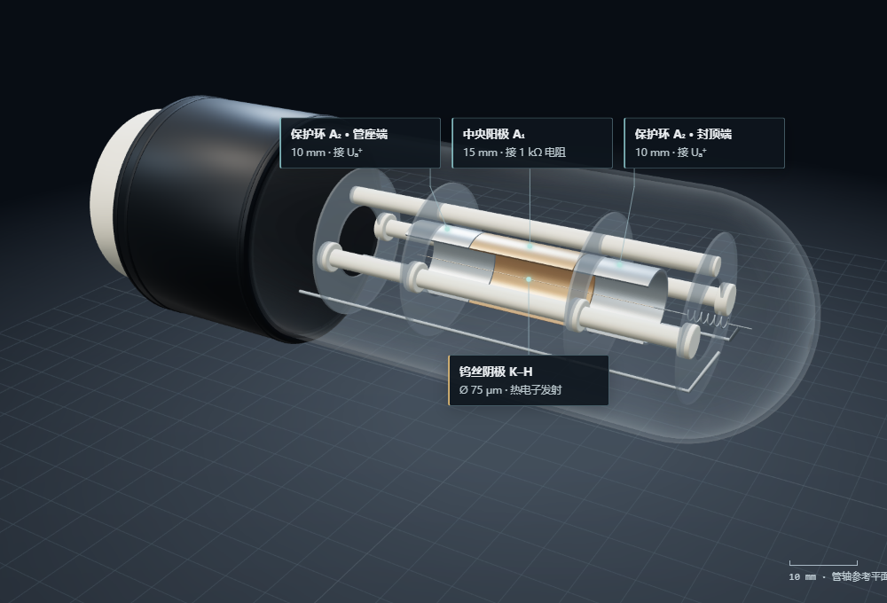
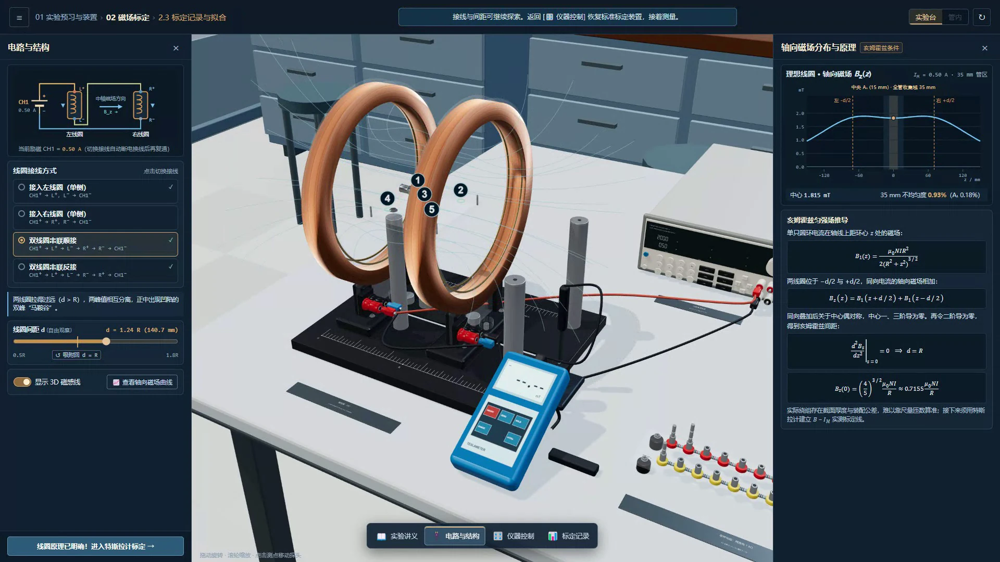
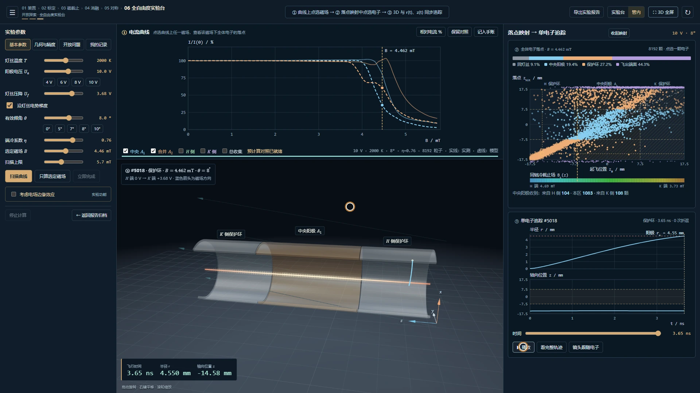
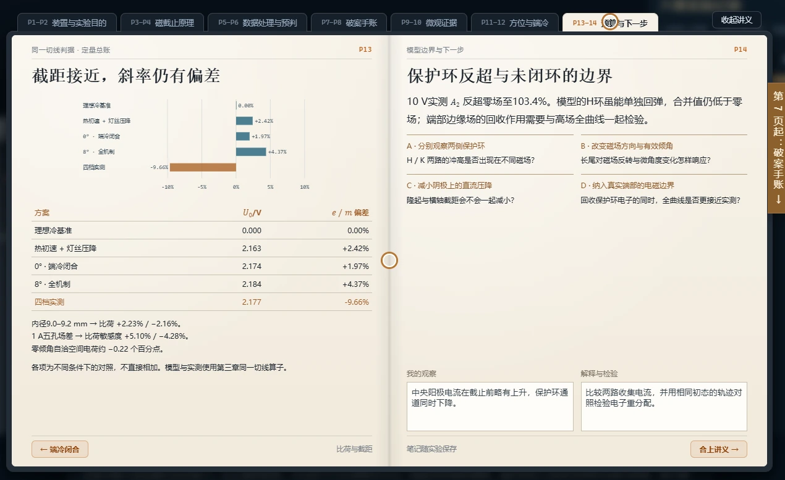

# 磁截止实验室（MagnetronLab）

**面向近代物理实验“磁控条件法测电子比荷”的开源三维虚拟仿真、实测数据复现与非理想机制探究平台。**

[]()
[]()
[-00599c)]()
[]()
[](LICENSE)
[](LICENSE)


**从两块毫伏表的反常读数出发，回到真空二极管内部追踪电子的运动与收集。**  
2026 年第十二届全国大学生物理实验竞赛（创新）一等奖作品 · 开源三维虚拟实验台、C++17 粒子动力学求解器与双通道实测数据集

<p align="center">
  
  <br>
  <sub>第四幕实机回放 · 追踪电子 #6413。看右侧半径曲线的波峰，每个峰对应左侧轨迹的一次向外运动。</sub>
</p>

<p align="center">
  <a href="docs/磁截止实验室_设计报告.pdf"><b>阅读完整 54 页设计报告（PDF）</b></a> ·
  <a href="#实验台与沙盘">实机截图</a> ·
  <a href="#怎么在自己的电脑上跑起来">快速运行</a> ·
  <a href="data/">公开实测数据集</a> ·
  <a href="research/">四份独立物理复核手稿</a> ·
  <a href="docs/PHYSICS.md">模型与边界说明</a>
</p>

---

## 一、从 1921 年的赫尔公式，到实验台上的两块毫伏表

真空二极管是电子学史上最早的器件。1883 年爱迪生在碳丝灯泡里偶然观察到热电子发射，1904 年弗莱明据此制成第一只用于无线电检波的真空二极管；到了 1921 年，Albert W. Hull 在 *Physical Review* 上发表了同轴圆柱电极在轴向匀强磁场中的电子运动理论（[Phys. Rev. 18, 31](https://journals.aps.org/pr/abstract/10.1103/PhysRev.18.31)）。一个世纪过去，日常电路里的真空管早已被半导体取代，同构的磁控管走向了雷达与微波工程，但这只封在玻璃壳里的同轴二极管依然留在各地高校的近代物理与普通物理实验台上。原因很简单：一根半径 $a$ 的炽热钨丝与一只内半径 $b$ 的同轴金属圆筒，在径向电场和轴向磁场的共同约束下，借由能量守恒与绕轴正则角动量 $P_\phi = m_e r^2\dot\phi - \frac{1}{2}eBr^2$ 守恒，就能给出了一个干净的临界磁场阈值——这便是经典的磁控条件法（磁截止法）测电子比荷 $e/m$。

然而，真正坐到实验室的台架前，学生看到的完全是另一番景象。

在实体装置里，直径 $75\ \mu\text{m}$ 的钨丝和内径约 $9.1\text{ mm}$ 的三段式收集圆筒全部封在金属腔体内部。隔着玻璃壳，人眼看不见电子的加速、回旋、折返与跨段迁移；学生能接触到的，只有外部电源旋钮和毫伏表上的数字。而当你老老实实记下 $U_a = 4, 6, 8, 10\text{ V}$ 四档加速电压下随励磁电流变化的阳极电流时，画出来的曲线有三个地方明显不肯服从讲义上的理想阶跃台阶：

1. **单点比荷随电压剧烈漂移**：如果直接把电源标称电压 $U_a$ 代入理想赫尔公式，四档电压算出的单点比荷全部系统性偏高，且电压越低越离谱——$4\text{ V}$ 档偏高 **$+99.1\%$**，一路滑到 $10\text{ V}$ 档仍偏高 **$+15.5\%$**；
2. **截止前电流反常抬升**：电流在进入陡降区之前并没有维持水平平台，而是在临界场前翘起一个比零场基线高出 **$0.5\%\text{--}2.6\%$** 的小峰；
3. **高场下拖出长尾**：哪怕磁场已经远超理论临界值（如 $5.74\text{ mT}$），电流也迟迟不归零，而是留下一条占零场电流 **$9.0\%\text{--}16.3\%$** 的平缓长尾。

在受学时限制的常规实验课上，两边保护环支路通常只接到加速电源上而不串表测量。面对这些偏离，最省事的办法是在实验报告末尾写上“仪器误差”四个字，交表走人。

| 返场补测的实体实验台（双毫伏表同步测 $A_1$ 与 $A_2$） | 按实物重建的 WebGL 三维实验台 |
| :---: | :---: |
|  |  |

这个项目起于 2026 年秋天一次不打算止步于“仪器误差”的返场实验。

**第一次转折发生在 2026 年 9 月的物理实验中心。** 我们回到同一套实验台前，把平时被忽略的两侧保护环合并支路（$A_2$）也串入 $1\text{ k}\Omega$ 取样电阻、接上第二块数字毫伏表，与中央阳极（$A_1$）同步采集四档电压下 71 个磁场点的双通道电流，并在空载条件下完成了定位板五孔位的霍尔探头磁场标定。第二块毫伏表一接上，我们最初的直觉猜测（“是不是磁场改变了阴极附近的空间电荷，让灯丝总发射流变大了？”）当场被证伪：在 $10\text{ V}$ 低场段，当中央阳极电流 $I_{\mathrm{A1}}$ 抬升 $+0.320\ \mu\text{A}$ 时，保护环电流 $I_{\mathrm{A2}}$ 恰好对称地下跌了 $-0.315\ \mu\text{A}$，两路合流几乎水平。**电子并没有多发射，它们只是在磁场作用下跨越电极间隙，重新分配了落点。**

**第二次转折发生在 2026 年 11 月初的几何重建。** 在 9 月提交的初赛原型里，我们沿用了未经核实的经验尺寸（假设收集区长 $20\text{ mm}$、灯丝半径 $50\ \mu\text{m}$）。在那套尺寸下，无论怎么调整磁场与管轴的倾角，模拟出的高场长尾都无法与实测定量闭合。直到我们重新翻出电子管技术参数卡，并对带毫米标尺的多视角微距实拍照片做单视图透视几何重建，确认真实管芯是**中央阳极 $15\text{ mm}$ + 两侧保护环各 $10\text{ mm}$（总收集域 $35\text{ mm}$）、钨丝直径 $75\ \mu\text{m}$（半径 $37.5\ \mu\text{m}$）、阳极内半径 $4.55\text{ mm}$**——换上真实几何后，此前卡住的倾角模型在 $8^\circ\text{--}9^\circ$ 等效倾角下自然闭合了高场长尾；而同一个灯丝端冷系数 $\eta = 0.76$ 也同时把四档电压的零场分流比 $I_{\mathrm{A2}}/I_{\mathrm{A1}}$ 锁进了实测区间（$0.809\text{--}0.822$ 对实测 $0.810\text{--}0.816$）。

<p align="center">
  
</p>

在日常教学里，每个学生不可能都有机会拆机返场、重搭双路采表，更没法亲手拧开玻璃管去单独关掉灯丝压降或热初速。于是我们把这趟“返场实测 + 五层第一性原理粒子动力学求解”做成了**磁截止实验室**：让学生在同一个三维实验台上既能看清两块毫伏表的每一次跳动，又能剖开管芯，亲手做控制变量消融，看清每一个反常读数背后的电子轨道。

---

<a id="怎么在自己的电脑上跑起来"></a>

## 二、怎么在自己的电脑上跑起来

平台完全在本地运行（`127.0.0.1`），不需要联网，也不控制实体硬件。配备集成显卡的普通轻薄本即可流畅运行。

### 方式一：Windows 免安装离线包（适合课堂分发与直接体验）

前往本仓库的 [Releases](../../releases) 页面下载 `MagnetronLab-Windows-x64.zip`。完整解压后双击 **`启动实验室.cmd`**，浏览器会自动打开三维实验台，无需安装 Python、Node.js 或 Blender。

### 方式二：从源码运行（Windows / Linux / macOS）

本仓库已在 `frontend/node_modules/three/` 中内置了按依赖关系裁剪的离线 Three.js 核心模块（仅 14 个文件、2.14 MB），**克隆后无需执行 `npm install`**。

**1. 安装 Python 科学计算依赖（Python 3.10+）**

```bash
git clone https://github.com/<your-username>/MagnetronLab.git
cd MagnetronLab
pip install -r requirements.txt
```

**2. 编译 C++17 原生动力学内核（Windows x64 已预编译，可跳过）**

Windows 环境下已随仓库提供编译好的 `magnetron_core.dll` 与 `edge_core.dll`。在 **Linux 或 macOS** 下，请先运行两行编译脚本（需系统装有支持 C++17 的 `g++` 或 `clang++`）：

```bash
bash backend/physics/native/build_unix.sh
bash backend/physics/edge_native/build_unix.sh
```

> 若未编译原生内核，主同轴/倾角引擎会自动回退至纯 Python 求解器（也可设置 `MAGNETRON_FORCE_PYTHON_KERNEL=1` 强制触发），但全扫耗时将显著长于 C++17 内核；第六幕的有限开口边缘场实时计算需要编译 `edge_core`。

**3. 启动实验室**

```bash
python run.py --port 8877 --open
```

Windows 用户也可直接双击仓库根目录的 `启动实验室.cmd`。服务启动后浏览器访问 `http://127.0.0.1:8877/`。

---

## 三、六幕探究：把“抄表算比荷”还原为一次追因过程

为了不让软件退化成另一个“输入参数、吐出标准曲线”的演示动画，我们将整个交互设计为六个循序渐进的章节。前三幕留在宏观实验台，让学生先撞上真实的测量困境；后三幕剖开真空管，每次只放开一个物理自由度做受控消融与单粒子反事实对照：

<a id="实验台与沙盘"></a>

| 在实验台上标定磁场 | 在沙盘里追踪单个电子 |
| :---: | :---: |
| [](docs/images/coil-bench.webp) | [](docs/images/trajectory-sandbox.webp) |

左图的五个孔位对应五次探头读数。右图把视角移进真空管，可以从曲线上选一个磁场，再从落点图里挑一颗电子，看它沿哪条轨道抵达电极。点击图片可看原图。

| 幕次 | 场景与核心操作 | 这一幕真正要回答的问题 |
| :---: | :--- | :--- |
| **第一幕**<br>装置与预习 | 拆看 `10 + 15 + 10 mm` 三段式管芯，完成电路核对，在理想冷电子沙盘中连续拖动磁场 | 保护环为什么要与中央阳极同电位、却要分开测流？理想磁截止的“相切折返”在几何上长什么样？ |
| **第二幕**<br>磁场标定 | 在透明定位板中心与四角共 5 个孔位上完成 8 档励磁电流的霍尔探头测绘与线性回归 | 亥姆霍兹线圈反接会怎样破坏匀强区？如何建立 $B = 4.231\,I_M - 0.188\ (\text{mT})$ 的空间均值标定？ |
| **第三幕**<br>实测与比荷 | 实测 $4, 6, 8, 10\text{ V}$ 四档磁截止曲线，对比单点比荷与 $B_c^2\text{--}U_a$ 多电压回归 | 为什么 $4\text{ V}$ 单点比荷会偏高 $+99.1\%$？横轴截出的 $U_0 = 2.18\text{ V}$ 固定电势偏移从何而来？ |
| **第四幕**<br>零倾角消融 | 开启“热初速 × 灯丝压降” $2\times 2$ 正交消融，追踪代表电子 `#6413` 的局域等势反事实轨迹 | 截止前 $+0.5\%\text{--}2.6\%$ 的小峰究竟是发射增强，还是轴向热初速与 $3.68\text{ V}$ 压降协同造成的跨区延迟收集？ |
| **第五幕**<br>倾角与长尾 | 引入磁场等效倾角 $\theta$，观察电子 `#3415` 的 27 圈回环与 4 圈越障，旋转 72 发射方位角命运轮 | 当轴对称破缺打破正则角动量 $P_\phi$ 守恒时，横向洛伦兹力矩如何把特定方位的电子一步步推过磁势垒？ |
| **第六幕**<br>边界与沙盘 | 调节灯丝端冷系数 $\eta$、切换有限开口 Laplace 边缘场（追踪 `#4571` 管口折返），进入全自由度沙盘 | 哪些反常已经被现有五层模型闭合？还有哪些余差没有闭合，怎样把它们带回实体实验室继续检验？ |

伴随六幕推进，右侧的 **14 页电子实验手账（P1–P14）** 会实时记录学生采集的数据、拟合参数与对照结论，并支持一键导出自包含的离线 HTML 实验报告（含矢量 SVG 图表、MathML 公式与个人思考记录，可直接浏览器打印归档）。

<details>
<summary>翻开实验手账 · 截距反演与保护环反超</summary>

[](docs/images/experiment-notebook.webp)

</details>

---

## 四、哪些现象已经被模型解释，哪些还没有

一部诚实的物理作品，不仅要交代模型做对了什么，更要如实划定它在哪里停下。全部定量推导与对照图表详见仓库内的 [**《磁截止实验室设计报告》（54 页 PDF）**](docs/磁截止实验室_设计报告.pdf) 第五章与 [`research/`](research/) 目录下的四份独立复核手稿。

### 1. 不靠自由调参、已由正向物理模型闭合的四项事实

- **横轴电势截距 $U_0 = 2.18\text{ V}$ 与单点比荷漂移**：实测直热式钨丝两端加热电压为 $U_f = 3.68\text{ V}$（H 端共地 $0\text{ V}$，K 端 $+3.68\text{ V}$），中点有效加速电压天然降低 $U_f/2 = 1.84\text{ V}$，其余约 $0.34\text{ V}$ 来自轴向电势梯度与 $2000\text{ K}$ 热初速拉宽截止斜坡后、双切线交点算子取在坡面上沿的几何效应。**仅向三维粒子模型输入实测 $U_f = 3.68\text{ V}$（零自由参数拟合），正向算出的横轴截距即为 $U_0 = 2.16\text{--}2.18\text{ V}$，与实测 $2.18\text{ V}$ 定量吻合。**
- **截止前电流抬升与双路分流对消**：$2\times 2$ 正交消融证明，单开热初速或单开灯丝压降时截止前电流变化均在 $\pm 0.06\%$ 以内；唯有两者同时开启（尤其是轴向热初速 $v_{z0}$ 与轴向压降耦合），原属 H 侧保护环的电子在长回旋飞行中向高电势侧漂移并改落中央阳极（如电子 `#6413` 飞行时间由零场 $5.68\text{ ns}$ 拉长至 $16.58\text{ ns}$、轴向漂移 $+2.23\text{ mm}$ 越过 $z = -7.5\text{ mm}$ 分界线），才复现出截止前陡升，并与双通道一升一降的实测分账互证。
- **高场残余长尾与方位角筛选**：在同轴零倾角（$\theta = 0^\circ$）下，即使赋予 $2000\text{ K}$ 热初速，高场 $5.735\text{ mT}$ 处两路电流也严格为 $0.00\%$（代表电子 `#3415` 连续回环 27 圈、$P_\phi$ 守恒漂移 $< 5\times 10^{-8}$，最终撞回灯丝）。引入 $\theta = 8^\circ$ 等效倾角后，横向磁场分量的角向力矩每圈将 $P_\phi/m_e$ 向负值推移，4 圈后近心点半径由 $0.294\text{ mm}$ 逐圈外移至 $1.589\text{ mm}$，在 $29.2\text{ ns}$ 越障命中阳极；72 方位角筛选（27 发中 $A_1$、2 发中 $A_2$、38 发轴向逸出、5 发返阴极）定量复现了 $8^\circ\text{--}9^\circ$ 下的高场平缓长尾。
- **零场分流比与保护环 $4.5\text{ mT}$ 局部超基线峰**：抛物线端冷权重 $w(z_0) \propto 1 - \eta(2z_0/L)^2$ 以单一系数 $\eta = 0.76$ 同时闭合四档电压的零场分流比；而在扩展域求解有限开口圆筒 Laplace 方程后，K 端管口附近的轴向电场 $\partial\phi/\partial z$（$r=1\text{ mm}$ 处）从筒内的 $+0.033\text{ V/mm}$ 反转为 $z=16\text{ mm}$ 处的 $-0.294\text{ V/mm}$，将原本沿轴逃逸的电子（如 `#4571`，贡献净增收的 $94.7\%$）拉回 K 侧保护环，在 $\theta=7^\circ, \eta=0.76$ 下复现出 $4.5\text{ mT}$ 处 **$104.6\%$** 的保护环局部反超峰（实测为 **$103.4\%$**）。

### 2. 尚未被当前模型闭合的四处边界（以及为什么我们保留了它们）

在完全相同的双切线交点算子下，四档实测 $B_c^2\text{--}U_a$ 回归斜率给出的电子比荷为 $1.589\times 10^{11}\text{ C/kg}$（相对 CODATA 标准值偏差 **$-9.66\%$**；若改用拐点最大负斜率算子 M3，则实测偏差为 **$-13.1\%$**），即**实测临界磁场整体比零倾角模型高出约 $6\%$**。

为了查明这 $6\%$ 的临界场标度差，我们没有做凑数拟合，而是逐一做了定量证伪与误差预算（详见 [research/02_nonideal_em_bias_audit.md](research/02_nonideal_em_bias_audit.md) 与 [research/03_self_consistent_space_charge.md](research/03_self_consistent_space_charge.md)）：
- **阳极内径公差（$9.0\text{--}9.2\text{ mm}$）**：对临界场贡献 $\pm 1.1\%$（对应比荷 $\pm 2.2\%$）；
- **五孔霍尔标定空间均值不确定度**：约 $\pm 1.0\%$（即使取五孔极差作为极端系统偏移上限也仅 $\pm 2.5\%$）；
- **稳态轴对称空间电荷（2D Poisson–Vlasov 自洽迭代）**：在校准到实测零场合流的 $\sim 44\ \mu\text{A}$ 发射电流下，管内虽存在约 $0.20\text{--}0.32\text{ V}$ 的空间电荷势阱，但由于轴对称静场下电子首尾能量与正则角动量守恒，可达性阈值仍由电极边界电势决定，**自洽空间电荷仅使反算比荷下移 $0.20\text{--}0.23$ 个百分点（对应临界场约 $0.1\%$）**，远远不足以解释实测的偏低。

即便把上述三项按同向上限叠加，也只能覆盖临界场偏差的 $2.2\%\text{--}3.7\%$，剩余的标度差（以及 $B/B_c < 0.89$ 低场区约 $1\%$ 的缓慢分流漂移、开口边缘场在高场区对中央通道的过耦合、实拍 $43\text{--}54\text{ mm}$ 钨丝夹持跨度对 $35\text{ mm}$ 收集域内有效压降的折减）依然是**未闭合的真实物理问题**。

我们在软件第六幕的最后一页（手账 P14）如实向学生摊开了这张误差预算表，并把四处未闭合边界转化成了**四项可以带回实体实验室的进阶实验方案**：
- **方案 A（分测两侧保护环）**：将 H 端与 K 端保护环独立引出测流，直接检验管口边缘场拉回电子是否集中在 K 侧；
- **方案 B（管座微倾角垫片补偿）**：主动微调管轴与线圈夹角，检验高场长尾是否在特定补偿角下趋近极小值；
- **方案 C（方波脉冲断流等势采样）**：利用钨丝热惯性，在切断加热电流（$U_f = 0\text{ V}$）的短暂等势窗口内采样收集电流，检验 $2.18\text{ V}$ 截距与截止前隆起是否同步消失；
- **方案 D（管芯原位三维测场与端部边值求解）**：把微小霍尔探头伸入真实管芯位置原位测绘磁场，分辨剩余的 $6\%$ 临界场偏差究竟来自标定板位置差还是电极内径。

> 虚拟仿真的价值，从来不是替学生抹平实验台上的毛刺，而是帮他们看清哪些毛刺已经被现有理论接住、哪些毛刺正指向下一个值得动手的真问题。

---

## 五、软件架构与数值基准

为了让普通机房电脑和轻薄本（无独立显卡）也能在拖动滑块时实时跑通数十万条三维洛伦兹力轨道，系统采用 **WebGL 2 三维前端 + Python 本地进程池调度 + C++17 原生自适应积分内核** 三层架构：

```text
浏览器前端 (Three.js / WebGL 2：材质批次合并 49 Draw Calls + 六幕自适应 UI + 14 页手账)
        │  本机 HTTP / JSON 增量流式轮询 (127.0.0.1)
        ▼
Python 本地服务 (backend/server.py：任务抢占取消 + 常驻 6 进程扫描池 + 终态哈希缓存)
        │  ctypes 双精度数组零拷贝桥接
        ├──▶ C++17 同轴/倾角内核 (magnetron_core：Sobol 准随机序列 + DOPRI5(4) + 步内四次多项式求根)
        └──▶ C++17 有限开口边缘场内核 (edge_core + SciPy 稀疏对数网格 Laplace 求解器)
```

在未配备独立显卡的普通办公笔记本（Intel Core i5-13420H，16 GB RAM，Intel UHD 核显）上实测的数值精度与响应耗时（详见设计报告第三章与第七章）：

| 检验维度 | 检验工况与对照基准 | 实测结果 |
| :--- | :--- | :--- |
| **理想临界场解析精度** | 冷电子、等势阴极（$U=8.16\text{ V}$），解析临界场 $B_c = 4.234455\text{ mT}$ | 步内求根误差 **$< 10^{-5}\text{ mT}$** |
| **守恒量长期稳定性** | 同轴零倾角 $B = 5.735\text{ mT}$，单电子连续回环 27 圈（$198.7\text{ ns}$） | 正则角动量 $P_\phi$ 相对漂移 **$< 5\times 10^{-8}$** |
| **准随机抽样收敛性** | $U_a = 10\text{ V}, B = 4.00\text{ mT}$，Sobol 序列 8192 vs 32768 粒子 | 中央阳极电流偏差仅 **$0.05\%$** |
| **零倾角全曲线扫场** | 42 个磁场点 × 4096 粒子（冷缓存首算 / 终态缓存命中） | **`0.64 s`** / **`0.02 s`** |
| **三维倾角渐进式全扫** | 第五幕拖动倾角滑块：1024 粒子首条预览浮现 / 29 点 × 8192 粒子全完成 | **`0.27 s`** / **`2.20 s`** |
| **端冷系数 $\eta$ 实时重权** | 第六幕基于预存矩 $(n - \eta q_{\text{sum}})$ 连续拖动滑块（中位数 / P95） | **`4.9 ms`** / **`6.3 ms`** |

---

## 六、仓库导览

```text
MagnetronLab/
├── run.py                          # 本地服务统一启动入口（同时托管 Web 界面与 JSON API）
├── 启动实验室.cmd                  # Windows 源码一键启动脚本
├── requirements.txt                # Python 运行依赖（numpy, scipy, psutil）
├── docs/
│   ├── 磁截止实验室_设计报告.pdf   # 完整 54 页参赛设计报告（原理推导、实测分析、架构与教学设计）
│   ├── PHYSICS.md                  # 五层物理模型、控制方程、误差预算与四项后续实验方案速览
│   ├── API.md                      # 本地 HTTP 流式计算接口文档（/api/scan, /api/trace, /api/edge/*）
│   ├── DEVELOPMENT.md              # C++17 跨平台编译、自动化回归测试与离线包打包指南
│   ├── TEACHING_GUIDE.md           # 课前/课中/课后教学组织建议，以及接入其他高校实测数据的步骤
│   └── images/                     # 管芯剖视渲染图、实体实验台实拍图与三维重建对比图
├── data/                           # 公开实测数据集（CC BY 4.0）
│   ├── calibration_8x5.csv         # 8 档励磁电流 × 5 孔位空载霍尔标定表
│   ├── magnetic_scan_4_6_8_10V.csv # 4/6/8/10 V 双通道（中央阳极 A1 + 保护环 A2）扫场实测数据（594 行）
│   ├── voltage_scan_high_field.csv # 高磁场条件下的加速电压扫描实测数据（286 行）
│   └── geometry_spec.json          # 透视重建确认的三段式管芯几何参数与标定回归系数
├── research/                       # 四份独立物理复核手稿与配图（标定交叉复算、比荷偏差、自洽空间电荷、开口边缘场）
├── backend/
│   ├── server.py & settings.py     # HTTP 服务、常驻进程池管理与参数契约
│   └── physics/                    # Python 调度层 + C++17 主内核 (native/) + 边缘场内核 (edge_native/)
├── frontend/
│   ├── index.html                  # WebGL 主入口（含精简离线 Three.js）
│   ├── chapter1/ ~ chapter3/       # 第一至三幕：装置认识、五孔磁场标定、四电压实测与比荷处理
│   └── chapters/                   # 第四至六幕：受控消融、倾角长尾、边缘场、14 页手账与离线报告导出
├── scripts/                        # 发射基底生成、预计算资产校验与误差预算复核脚本
├── tests/                          # 后端物理/边缘场测试、前端数学测试与 Playwright 浏览器端到端走查
└── packaging/                      # PyInstaller 免安装 Windows 离线发布包构建工具
```

---

## 七、关于“一人 + AI”的开发方式与致谢

这个项目从 2026 年 9 月的返场补测到 11 月的六幕重制，由作者一人在 AI 编程与文档工具辅助下完成；学校物理实验教学中心与指导教师为返场双通道补测提供了实验室场地与教学仪器支持。

在今天，用 AI 辅助写代码或排版文档已经不是新鲜事，但把整个过程走完，我们最深的一点体会是：**AI 可以极大地压缩“从明确规格到可用代码”的距离，却无法替人承担任何一步面向真实世界的物理判断。**
- 在这个项目里，C++17 `DOPRI5(4)` 内核的实现、Three.js 场景与 Blender 建模脚本、以及本报告的部分 LaTeX/TikZ 绘图代码都借助了 AI 工具的高效生成；在验收阶段，我们还专门拉起只读教学剧本的独立 AI 上下文，按初次接触实验的学生视角做全流程走查，挑出界面卡点。
- 但所有真正决定作品走向的节点——发现单通道曲线反常后决定重返实验室给保护环接上第二块毫伏表、在旧 $20\text{ mm}$ 几何无法闭合长尾时对着带标尺照片重新丈量出 $10 + 15 + 10\text{ mm}$ 的真实管芯、从单粒子正则角动量守恒想明白为什么管内 $0.3\text{ V}$ 的空间电荷势阱不能直接从端电压 $U_a$ 里扣掉、以及在最后决定如实保留那 $6\%$ 未闭合的临界场标度差而不是调参抹平——**没有一步能外包给模型**。先有人的怀疑、动手测量与物理把关，AI 才成为把想法变成现实的杠杆。

### 许可与引用

- **开源许可**：仓库内全部原创代码采用 [MIT License](LICENSE) 开源；[`data/`](data/) 实测数据集、[`docs/磁截止实验室_设计报告.pdf`](docs/磁截止实验室_设计报告.pdf) 及 [`research/`](research/) 研究文档采用 [CC BY 4.0](https://creativecommons.org/licenses/by/4.0/) 协议共享。
- **引用方式**：如在高校实验教学、课程讲义或研究论文中使用本软件、设计报告或实测数据集，请参考 [`CITATION.cff`](CITATION.cff) 引用本项目。
