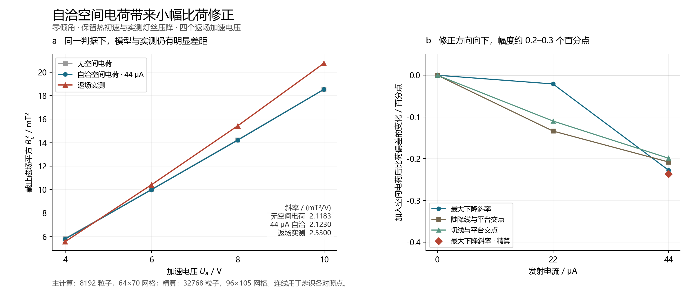

# 自洽空间电荷对比荷测量的影响

在保留热初速、实测灯丝压降并固定磁场与管轴平行的模型中，自洽空间电荷把反算比荷向下拉，但在本次实验对应的发射流下，只改变约 **0.2–0.3 个百分点**，不足以解释实测约 **13% 的偏低**。

## 计算结果

用中央阳极电流的最大下降斜率确定截止位置，随后对四组电压作带自由截距的拟合：

$$B_c^2=k(U_a-U_0),\qquad \frac em=\frac{8}{k\,b^2(1-a^2/b^2)^2}.$$

公式中的 $k$ 使用 $\mathrm{T^2/V}$；表格为便于阅读使用 $\mathrm{mT^2/V}$。输入真值为 $e/m=1.7588200084\times10^{11}\ \mathrm{C/kg}$。

| 条件 | k / (mT²/V) | U₀ / V | e/m / (10¹¹ C/kg) | 相对真值偏差 |
|---|---|---|---|---|
| 无空间电荷极限 | 2.118300 | 1.2560 | 1.824478 | +3.733% |
| 22 μA | 2.118725 | 1.2616 | 1.824112 | +3.712% |
| 44 μA | 2.122954 | 1.2802 | 1.820478 | +3.506% |
| 匹配四组实测合流 | 2.122772 | 1.2791 | 1.820635 | +3.515% |
| 返场实测 | 2.530027 | 1.8396 | 1.527570 | -13.148% |

“无空间电荷极限”通过无自场的测试粒子收集概率定义；它是 $I_{\rm emit}\to0$ 时归一化曲线的极限。22 μA 与 44 μA 则是实际进入泊松源项的电流，改变电流会重新改变轨迹和电荷分布。

44 μA 相对无空间电荷的比荷变化为 **-0.227 个百分点**。把每组源强分别校准到实测零场合流后，变化为 **-0.219 个百分点**。原模型和实测在这条测量链上相差约 16.88 个百分点，空间电荷补上其中约 **1.3%**。模型的最终比荷仍然偏高。

四组截止位置的成对变化为：

| 实测Uₐ / V | 无自场B꜀ / mT | 44 μA自洽B꜀ / mT | 变化 / μT |
|---|---|---|---|
| 3.993 | 2.414474 | 2.405424 | -9.05 |
| 5.993 | 3.163114 | 3.160017 | -3.10 |
| 7.992 | 3.772081 | 3.768803 | -3.28 |
| 9.993 | 4.306246 | 4.304982 | -1.26 |

低电压组前移更多，因而 $B_c^2$ 对 $U_a$ 的拟合斜率增大，比荷随之减小。方向与解释“偏低”相符；限制在幅度。

## 发射流与实测电流怎样对应

输入的发射流包含随后返回阴极或从端口离开的电子。测得的两路合流只包含抵达收集筒的电子。计算中先在零磁场求解自洽场，再调节源强，使模型的零场合流与实测一致；随后扫描磁场时保持该源强固定。

| Uₐ / V | U_f / V | 发射流 / μA | 模型零场合流 / μA | 实测零场合流 / μA |
|---|---|---|---|---|
| 3.993 | 3.6827 | 43.284 | 41.619 | 41.614 |
| 5.993 | 3.6846 | 43.852 | 42.996 | 42.996 |
| 7.992 | 3.6840 | 44.418 | 43.762 | 43.762 |
| 9.993 | 3.6795 | 44.856 | 44.297 | 44.297 |

源强只需在 43.3–44.9 μA 范围内变化。使用统一的 44 μA 不会改变判断。均匀发射、2000 K 是本次受控比较的模型条件；发射分布的空间变化留在独立的发射建模中处理。

## 自洽计算的物理内容

采用灯丝半径 $a=37.5\ \mu\mathrm m$、阳极内半径 $b=4.55\ \mathrm{mm}$、计算长度 $L=35\ \mathrm{mm}$。中央阳极占 $|z|\le7.5\ \mathrm{mm}$，两端保护环各长 10 mm。均匀发射长度及灯丝压降分布长度也取 35 mm。

阴极沿轴向的电势为

$$\phi_c(z)=U_f\left(\frac zL+\frac12\right).$$

总电势分为满足固定电极电势的真空解与空间电荷修正：

$$\phi(r,z)=\phi_c(z)+[U_a-\phi_c(z)]\frac{\ln(r/a)}{\ln(b/a)}-D(r,z).$$

$D$ 表示空间电荷引起的正的降势量。每次迭代按当前总电势推进电子：

$$\dot{\boldsymbol r}=\boldsymbol v,\qquad
m\dot{\boldsymbol v}=e\nabla\phi-e\boldsymbol v\times\boldsymbol B,\qquad
\boldsymbol B=B\hat{\boldsymbol z}.$$

初速度采用热发射通量分布，$\sigma^2=k_BT/m$：径向向外速度的密度为 $p(v_r)=v_r\exp[-v_r^2/(2\sigma^2)]/\sigma^2$，$v_r>0$；切向及轴向速度为均值零、方差 $\sigma^2$ 的高斯分布。所有对照复用同一批初态。

把每条轨迹在各网格单元内的驻留时间累计为电荷密度：

$$\rho_j=-\frac{I_{\rm emit}}{N\,\Delta V_j}\sum_{p=1}^N\int_0^{t_{\rm end,p}}S_j[\boldsymbol r_p(t)]\,dt.$$

$S_j$ 是对数径向—轴向网格上的双线性电荷沉积权重，满足 $\sum_jS_j=1$，因此沉积保留全部驻留电荷。

返回阴极的电子，其去程和回程均计入驻留电荷。电子抵达阴极、阳极或轴向边界后被吸收；达到积分时限的电子单独记为未决。正式结果中的未决数为零。

在 $x=\ln(r/a)$ 网格上解泊松方程：

$$[-\partial_x^2-r^2\partial_z^2]D=\frac{r^2|\rho|}{\epsilon_0},\qquad
\Delta V_j=2\pi r_j^2\sinh(\Delta x)\Delta z.$$

圆柱电极及模型的两个轴向端面取 $D=0$。得到新场后重新积分全部粒子、重新沉积，再求泊松场，直到未经松弛的场残差及各通道收集数同时稳定。这里已经包含场对轨迹、轨迹对电荷密度的反馈。

## 为什么降势约 0.3 V，比荷修正仍然很小

4 V 组截止附近的自洽降势峰值约 0.32 V；10 V 组约 0.20 V。这个峰值描述电子在管内经过的电势形状。电子最终抵达阳极时经历的总电势差，仍由它出发的阴极位置与阳极电势决定。

在此次静态、轴对称、轴向磁场模型中，单粒子的能量与正则角动量守恒：

$$\mathcal E=\frac12mv^2-e\phi,\qquad
P_\theta=mr v_\theta-\frac{eBr^2}{2}.$$

对于冷电子从阴极出发，达到阳极必须满足

$$e[U_a-\phi_c(z_0)]\ge\frac{e^2B^2(b^2-a^2)^2}{8mb^2}.$$

这个由两端电势决定的可达性上界保持不变。空间电荷会改变中途势垒、飞行时间、轴向与径向运动之间的能量分配，以及最终落入哪段阳极，因此会移动系综电流曲线上的最大斜率位置。此次计算表明，这项移动只有数微特斯拉至约十微特斯拉。把管内最大的 $D$ 直接从加速电压扣掉，会高估比荷修正。

## 截止判据与精度复核

实验和模拟采用同一套原始磁场采样点和处理规则。M3 为五点二阶平滑、求导，并对导数极小值附近三点作抛物线插值；M4 为陡降段四点直线与低场平台拟合线的交点；M5 为 M3 位置处切线与零场平台的交点；M6 为半高位置。比较使用中央阳极电流。

| 判据 | 无自场偏差 | 44 μA自洽偏差 | 变化 / 百分点 | 实测偏差 |
|---|---|---|---|---|
| M3 | +3.733% | +3.506% | -0.227 | -13.148% |
| M4 | +2.032% | +1.824% | -0.208 | -8.391% |
| M5 | +1.285% | +1.087% | -0.199 | -8.947% |
| M6 | -0.036% | -0.111% | -0.075 | -14.557% |

原始相邻点法 M1 和直接选择平滑后最陡采样点的 M2，在本次小修正下未跳到新的磁场采样点，因此给出相同的截止值；它们对这种微小移动的分辨力不足。

主计算为 8192 粒子、64×70 的对数径向—轴向网格。对决定 M3 的完整原始数据窗口，另用 32768 粒子、96×105 网格、$10^{-9}$ 轨道相对容差及更严格的场残差重算。精算的比荷偏差从 **+3.776%** 变为 **+3.539%**，对应变化 **-0.236 个百分点**，确认了主结果的方向和数量级。两种设置之差是数值敏感性检查，不作为统计置信区间。

独立的 SI 单位 DOP853 积分复核了 28 条代表轨道，终态分类全部一致，飞行时间最大相对差为 $4.33\times10^{-6}$；泊松制造解最大绝对势误差约 $2.00\times10^{-4}\ \mathrm V$，近阴极薄壳的格林函数检验相对误差约 $5.86\times10^{-5}$。另从真空场与两倍降势场出发求解同一个 4 V 截止附近工作点，两次得到相同的中央和保护环收集数。

额外尝试的 88 μA 对照，在 4 V 的若干点未满足固定点收敛标准，已保留未收敛标记并排除在上述结果之外。该数值现象需要更高采样或时间演化研究，不能据此判定真实管内出现不稳定。

## 结论的使用范围

本次完成的是**零倾角、均匀热发射、给定端面边界的轴对称稳态自洽计算**。这一计算已足以否定“仅用静态空间电荷降势就能补足本模型约十几个百分点差额”的估计。倾斜磁场下的三维空间电荷、时变集体运动和真实端部边缘场，需要各自相应的模型；本次结果未包含这些耦合。

据此，当前报告可写为：

> 在零倾角、均匀热发射及给定端面边界的轴对称稳态模型中，自洽空间电荷给出朝比荷减小方向的小幅修正。在与实测零场合流相容的发射强度下，该修正约为 0.2–0.3 个百分点，尚不足以解释实测比荷偏低约 13% 的幅度。

## 数据与复现

- `main_N8192_G64/fits.csv`、`cutoffs.csv`：三组已收敛发射强度的完整扫描及六种判据；每个点的电势、终态、驻留分布、未经松弛的迭代残差保存在对应 `points_*` 文件夹。
- `refined_N32768_G96/M3_fits.csv`、`M3_cutoffs.csv`：更高精度的成对复算。
- `matched_measured_current/`：逐电压匹配实测零场合流的源强、截止位置及拟合。
- `判据对照.csv`、`截止位置成对变化.csv`：主要数值。
- `solver_checks.csv`、`independent_DOP853.csv`、`seed_checks.csv`：独立验证与不同初始场比较。
- `model_manifest.json`：模型配置、输入数据与代码摘要。

轨道—泊松迭代的通用方法可参看 [IBSimu 官方 Vlasov 教程](https://ibsimu.sourceforge.net/vlasov2d/index.html)。本目录的数值来自独立实现及本机运行，采用本实验的几何、初态和吸收边界。
